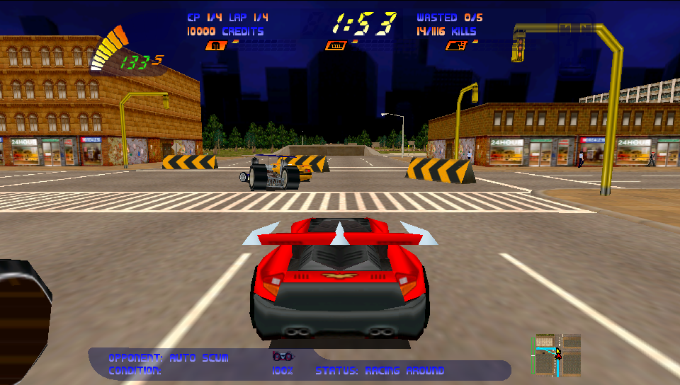
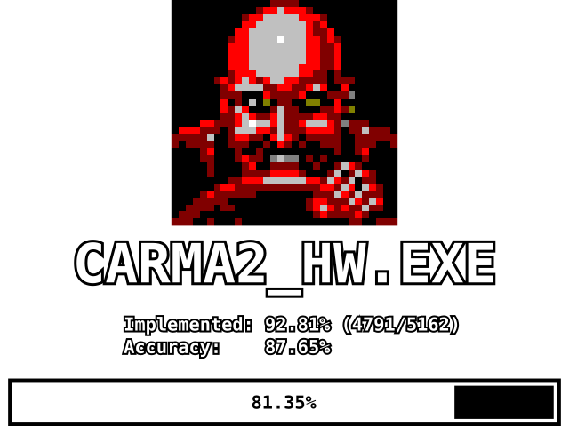

# Carpocalypse 2 – PS Vita port

<p align="center">
  
</p>

A native **PS Vita** port of *Carmageddon II: Carpocalypse Now* (1998), built on
the Carpocalypse 2 decompilation by
[Link4Electronics/Carpocalypse2](https://github.com/Link4Electronics/Carpocalypse2).
This fork's main focus is the Vita build (v1.0). Along the way it also continued
the decompilation, fixed a number of bugs in the game code, and extended the
PC (Windows) port; see [Changes in this fork](#changes-in-this-fork).

The repository and the release contain **no game data**. You need your own,
legally obtained copy of the PC game (for example the GOG release).



*The port at the PS Vita resolution (960x544, desktop build).*

## PS Vita

3D rendering runs on the Vita GPU through
[vitaGL](https://github.com/Rinnegatamante/vitaGL); input, audio and files go
through [SDL3](https://github.com/libsdl-org/SDL).

### Requirements

- A PS Vita or PS TV with HENkaku/Ensō and [VitaShell](https://github.com/TheOfficialFloW/VitaShell).
- `libshacccg.suprx` in `ur0:data/` (or `ur0:data/external/`). vitaGL needs it
  to compile the shaders on the console. Extract it with
  [ShaRKF00D](https://github.com/Rinnegatamante/ShaRKF00D) if you do not have it yet.
- The PC game's `DATA` and `MUSIC` folders (about 700 MB together).

### Installation

1. Download `carpocalypse2-vita-v1.0.vpk` from the [Releases](../../releases)
   page and install it with VitaShell.
2. Copy the game files from your PC install to the memory card so that you get:

   ```
   ux0:data/c2port/DATA/DATA.TWT      (and the rest of the DATA folder)
   ux0:data/c2port/MUSIC/Track02.ogg  ... Track08.ogg   (optional, in-game music)
   ```

   Upper/lower case of file and folder names does not matter.
3. Start **Carmageddon 2** from the LiveArea.

Settings, saved games and logs are kept in `ux0:data/c2port/`, so updating the
VPK keeps them.

### Controls

| Vita control | Driving | Menus |
|---|---|---|
| Left stick / D-pad left, right | Steering | Navigate |
| R | Accelerate | |
| L | Brake / reverse | |
| Cross | Handbrake | Confirm |
| Square | Hold to repair | |
| Circle | Recover | Back |
| Triangle | Change camera | |
| D-pad up | Use the selected power-up | Navigate |
| D-pad down | Next power-up | Navigate |
| Right stick | Look around | |
| Select (tap) | Full-screen map | |
| Select + Square / Triangle / Circle | Buy armour / power / offence | |
| Start | Pause / options | Back |

The gearbox is automatic. Keep the game's default keyboard bindings: the Vita
buttons are mapped onto them.

### Vita options

Options > Graphics has three extra settings on the Vita:

- **FRAME RATE**: 30 FPS (default, steady pacing), 60 FPS or unlimited.
- **SCENERY CUTOFF**: draw distance 35 (default), 80, 100 or 120. Longer
  distances look better but lower the frame rate on the bigger tracks.
- **FPS COUNTER**: shows the frame rate under the speedometer while racing.

### Known issues

- Long loading times when a race starts.
- The HUD is drawn in a 4:3 area in the middle of the widescreen display.

### Reporting bugs

If the game freezes, it closes itself after about 20 seconds and the Vita
writes a crash dump to `ux0:data/`. Please attach that `.psp2dmp` file together
with `VITA_BOOT.LOG` and `DIAGNOST.TXT` from `ux0:data/c2port/` to the issue.

### Building the VPK

Requirements: [VitaSDK](https://vitasdk.org/) with SDL3, vitaShaRK,
libmathneon, SceShaccCgExt and libzip installed through `vdpm`, and a local
clone of [vitaGL](https://github.com/Rinnegatamante/vitaGL) at commit
`7635e3ceb3c52e34ca2e51d2281628d6c756a35b`.

From Linux or WSL:

```sh
export VITASDK=/path/to/vitasdk
export C2_VITAGL_SOURCE=/path/to/vitaGL
bash scripts/packaging/build-vitagl.sh   # applies scripts/packaging/vitagl-patches, builds vitaGL
bash scripts/packaging/build-vita.sh     # builds the VPK (C2_VITA_BUILD_DIR selects the build directory)
```

`scripts/packaging/make-vita-bundle.py <small.vpk> <game-folder> <with-data.vpk>`
builds a VPK that carries your own DATA and MUSIC and installs them on first
start. That package contains game files, so keep it to yourself and do not
share it.

Host-side checks for the Vita code live in `scripts/packaging/test-vita-*.py`
and `test-vitagl*.py`. Notes on the HUD text batching are in
[packaging/vita/glyph-batching.md](packaging/vita/glyph-batching.md).

## Changes in this fork

Besides the Vita platform layer (`src/carma2/platform/sdl3/vita_*.c`), this
fork changes the shared game code and the PC port.

### Decompilation

Progress against the original `CARMA2_HW.EXE`, measured with
[reccmp](https://github.com/isledecomp/reccmp):

| | Original project (fork point) | This fork |
|---|---|---|
| Implemented functions | 3915 / 5162 (75.84%) | 4781 / 5162 (92.62%) |
| Accuracy | 60.72% | 85.74% |



Decompiled functions were checked against the original executable with
reccmp, and many of them also with differential tests that run the original
and the decompiled function in an x86 emulator on the same random inputs and
compare the results. That test tooling is not part of this repository.

### Bug fixes in the game code

Bugs found while playtesting, fixed in the shared code (so they apply to the PC
build too). Most were mistakes in the decompiled code; the ones marked
*original* are bugs of the 1998 game, fixed only in the port builds
(`CARPOCALYPSE2_FIX_BUGS`), never in the matching build. Some examples:

- Minimap: pedestrian and power-up blips were written at twice their row,
  which hid them and corrupted memory in pedestrian missions (crashes).
- Ped flamethrower power-up: the flames stayed in the air, and stopping a
  flame used the wrong index and could crash (*original*).
- Checkpoints never registered; smash-mission targets (antennas) could not be
  destroyed; the race-end time bonus was wrong.
- Pedestrian limb poses between physics steps, steering self-centring, split
  car mass/inertia, collision and impact handling, opponent paths, oil spills,
  cameras, replays and many more functions restored to the original behaviour.
- A freed menu backdrop was used again when leaving a menu (*original*).

### PC (Windows) port

- **OpenGL renderer.** The original project builds only the BRender software
  renderer for the SDL3 port; it already carried the sources of a BRender
  OpenGL driver (`src/brender/drivers/glrend`), but did not use them. This fork
  completes that driver and wires it into the SDL3 port (`sdl3_gl.c`) as a
  replacement for the 3dfx Glide / Direct3D renderers of the original game. It
  uses OpenGL 3.2 with the subset shared with OpenGL ES 3.0, so the same driver
  also runs on the Vita through vitaGL. On PC it is enabled with the environment
  variable `C2_RENDERER=gl`; without it the software renderer is used.
- **Widescreen and resolution.** With OpenGL the 3D view fills a widescreen
  window, while menus and the HUD stay 4:3 in the centre (menu backdrops are
  drawn across the whole width). Options > **Display** selects the resolution
  and window/fullscreen mode; the choice is saved in `C2DISPLAY.CFG`.
- **FPS counter**: Options > Graphics > FPS COUNTER (saved in `SHOWFPS.CFG`).
- **Crash reports**: an unhandled exception writes `CRASH.TXT` and `CRASH.DMP`
  next to the executable.
- **Loading**: packed `.TWT` archives are read on demand instead of being loaded
  whole, and loading phases are timed in `DIAGNOST.TXT`
  ([docs/lazy-twt.md](docs/lazy-twt.md), [docs/loadtime.md](docs/loadtime.md)).
- **Test harness** for development, controlled by environment variables
  (`C2_TEST_RACE`, `C2_TEST_KEYS`, `C2_TEST_MENU`, `C2_TEST_MAPVIEW` and others):
  starts a race directly and feeds keyboard input inside the process.

#### Running on PC

Build the executable (below) and copy `carpocalypse2.exe` and `SDL3.dll` into
your Carmageddon II install folder (the one that contains `DATA`, `MUSIC` and
`SMACKW32.DLL`). For OpenGL, start it with `C2_RENDERER=gl` set.

## Build requirements

- SDL3
- 32-bit x86 compiler:
  - MSVC 11.0 (Visual Studio 97 SP3) compiler for matching build, or
  - a modern MinGW or MSVC toolchain
- DirectX SDK: we need `dinput` and `dxguid`.
  - MinGW provides these libraries out-of-the box
  - MSVC does not ship with a *DirectX SDK*: this [time-period correct version on archive.org](https://archive.org/details/MicrosoftDirectX7SDK) works perfect.
- [libtiff](http://www.libtiff.org/): this library is used to convert tiff images to BRender pixelmaps

### Windows (PC port)

This is the configuration the fork was built and tested with: Visual Studio
2022 Build Tools in an x86 developer prompt, CMake with Ninja, and the SDL3 x86
development package.

```sh
cmake -S . -B build-sdl3 -G Ninja -DCMAKE_BUILD_TYPE=RelWithDebInfo \
    -DCARPOCALYPSE2_PLATFORM=SDL3 -DCARPOCALYPSE2_VENDORED=ON \
    -DSDL3_DIR=/path/to/SDL3-x86/cmake
cmake --build build-sdl3 --target carpocalypse2
```

The matching build (VC 5.0 / Visual Studio 97 SP3, `-DCARPOCALYPSE2_MATCHING=TRUE`)
and the reccmp report work as in `.github/workflows/reccmp-report.yaml`.

## Other platforms of the original project

The original project also provides Linux (AppImage) and Android (APK) builds.
They are kept here unchanged, but this fork has **not** built or tested them
with its changes. The instructions below are from the original project.

### Building on Linux

`sudo pacman -S cmake glslang sdl3`
```sh
mkdir build && cd build
cmake .. -DCMAKE_BUILD_TYPE=Release
make
```

### Linux (AppImage)

Copy the data from a legally obtained Carmageddon II install in:

   ```
   ~/.local/share/carpocalypse2/DATA/     game data (required)
   ~/.local/share/carpocalypse2/MUSIC/    CD audio as Track02.ogg ... Track08.ogg (optional)
   ```

### Android (APK)

Push the original game data onto the device:

   ```
   adb push /path/to/C2/DATA \
     /sdcard/Android/data/com.carpocalypse2.game/files/DATA
   ```

   The app requests no storage permission and can only read its own
   app-specific directory, which is the path above. The data must be pushed
   after the app has been launched at least once (that creates the
   directory). Note that some Android 11+ devices refuse `adb` access to
   `Android/data` entirely; an in-app importer for those devices is planned,
   and is the only blocker for a permissionless data setup.
Start the app. Touch input is passed to the game as the pointer, so menus
   and the original controls are usable without a mouse; the app runs in
   sensor-landscape.

Debug-signed builds can only be replaced with `adb install -r` while the
signature still matches — reinstalling over a future release-signed build
requires uninstalling first.

## Goals

- Exact same behavior as the original
- Matching binary

## AI assistance

The PS Vita port and the other changes in this fork were made with AI
assistance, using [Claude Code](https://claude.com/claude-code) and
[Codex](https://openai.com/codex/): decompiling functions and checking them
against the original executable, finding and fixing bugs from crash dumps and
logs, and writing the Vita platform layer and the OpenGL renderer integration.
Everything was playtested on a real PS Vita.

Thanks to Link4Electronics and the contributors of the original Carpocalypse2
decompilation, and to the authors of vitaGL, VitaSDK and SDL.

## Legal

Carpocalypse2 is a fan-made reverse-engineering research project,
licensed under the [GNU GPL v3](LICENSE). It contains no original game
code or assets — a legally obtained copy of *Carmageddon II:
Carpocalypse Now* is required to use it.

This project is not associated with, or endorsed by, SCi, Stainless
Software or THQ Nordic. All trademarks and copyrights related to
Carmageddon are the property of their respective owners.
